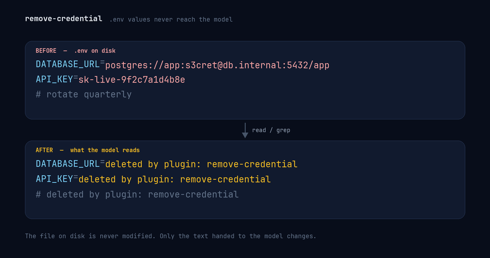

# remove-credential

DSH (DeepSeek Harness) の Host プラグイン。モデルがファイルを読むとき、**`.env` は値を消してキー名だけ**を渡し、**それ以外のファイルは `sk-` の API キーを `sk-removed-by-plugin` に置き換える**。



```
1: API_KEY=deleted by plugin: remove-credential
2: DATABASE_URL=deleted by plugin: remove-credential
3: # deleted by plugin: remove-credential
(End of file - total 3 lines)
```

ディスク上のファイルは一切変更しない。消えるのはモデルに渡るテキストと、セッションログに残る結果だけ。

`.env` 以外のファイルでも、`sk-` で始まる API キーはキー部分だけ置き換える:

```diff
- const key = "sk-test-1234567890abcdef"; // keep me
+ const key = "sk-removed-by-plugin"; // keep me
```

置き換えるのはキーそのものだけで、前後の引用符・カンマ・行の残りはそのまま残る。`task-runner` や `sk-learn` のような語は一致しない（`sk-` の直前が英数字なら対象外、後続は 10 文字以上）。

## 仕組み

`tools/post-execute` の waterfall で、確定した `read` / `grep` の結果を見る。

- **`read`**: basename が `.env` / `.env.*` / `*.env` なら値を「キー + マーカー」に、それ以外のファイルなら `sk-` キーだけを置き換える。
- **`grep`**: `matches[]` を 1 行ずつ、そのファイルに応じたルールで置き換える。

置き換えるのは `content` ではなく **`value`**。registry が value から本文と `presentationMeta` を再生成するので、モデル向けテキスト・セッションログ・UI カード・PTC のプログラム呼び出しのどこにも元の値が残らない。

ルールは 1 行単位:

| 入力 | 出力 |
|---|---|
| `API_KEY=sk-live-123` | `API_KEY=deleted by plugin: remove-credential` |
| `  export DB_URL="postgres://..."` | `  DB_URL=deleted by plugin: remove-credential` |
| `# メモや秘密が書かれたコメント` | `# deleted by plugin: remove-credential` |
| 複数行の値の続き行 | `# deleted by plugin: remove-credential` |
| 空行 | 空行のまま |

空の `KEY=` にすると「値が空の本物の行」に見えて書き戻しを誘うので、削除したことが分かるマーカーを値の位置に置く。マーカー文字列は `lib/redact.js` の `MARKER`。

`systemPrompt` があるプロファイルでは、`read` の説明直後に短いセクションを足して「置き換わっているのは仕様であり、推測・復元・書き戻しをしない」とモデルに伝える。

## インストール

```sh
git clone https://github.com/neutron42-jp/remove-credential
```

クローンしたディレクトリの絶対パスを `plugin_manager` に渡す:

```
plugin_manager install_bundle target=<clone したディレクトリの絶対パス>
```

`package.json` の `dsh.bundle.patch` が `cordis.patch.yml` を指し、`remove-credential` の行を 1 本 insert する。プロファイル全体に効き、再起動後も残る。

## テスト

```sh
npm test        # node --test
```

テストは純粋関数とリスナー配線だけを検証する。`.env` ファイルは 1 つも作らない・読まない（フィクスチャはインライン文字列）。

## 制限

- **`sk-` 系のみ**。`ghp_`・`AKIA`・`AIza`・JWT など他の形式は素通りする（`lib/redact.js` の `TOKEN_RULES` に足せば対応）。
- **`bash` / `terminal` は対象外**。`cat .env` や `curl` の出力は止められない。塞ぐなら別途 `tools/pre-execute` で bash を拒否するポリシーが要る。
- **ツール引数（入力）は書き換えない**。registry に引数書き換えの口がなく、できるのは拒否だけ。
- **書き込みは止めない**。`write` / `edit` はそのまま通る。値が見えない状態で `.env` を書き換えると壊す危険はあるので、必要なら mutation guard を足す。
- パターンは固定。変えたければ `lib/redact.js` の `ENV_NAME` を編集する。
- 対応ツールは `read` と `grep` の 2 つ。ツール名が変わったら `lib/redact.js` の分岐も直す。

## 構成

| ファイル | 役割 |
|---|---|
| `index.js` | リスナー登録とプロンプトセクション |
| `lib/redact.js` | 純粋な判定・置換ロジック |
| `cordis.patch.yml` | バンドルのパッチ（insert 1 行） |
| `locale/{en,ja}.json` | プラグイン一覧の表示名と説明 |
| `icon.svg` | アイコン（黒塗り 1 行の書類） |
| `docs/before-after.png` | README の before/after 図 |
| `docs/diagram.py` | その図の生成スクリプト（`python3 docs/diagram.py`） |

## License

MIT
